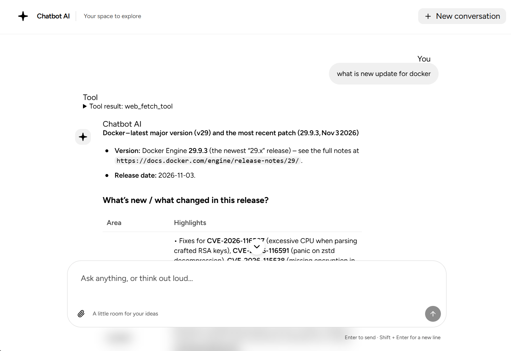

## Chatbot AI

A chatbot with a React web interface and a FastAPI server. The server can search engineering documentation in Qdrant and search the web to help answer questions.



---

### Prerequisites

| Item           | Requirement                                                                     |
| -------------- | ------------------------------------------------------------------------------- |
| Web            | Bun 1.3.14 or later and a supported Node.js version                             |
| Server         | Python 3.13 or later and uv                                                     |
| Vector store   | Running Qdrant instance                                                         |
| Model provider | OpenAI-compatible chat and embedding API                                        |
| Docker         | Docker Engine or Docker Desktop with the Compose plugin, for running containers |

---

### Local development

Set up and start the server, including document ingestion, using [server/README.md](server/README.md). Then install and start the frontend using [web/README.md](web/README.md).

The frontend normally runs at `http://localhost:5173` and proxies API requests to `http://localhost:8000`.

---

### Docker

`docker-compose.yml` defines web, server, and Qdrant services. From the project root, copy the example environment file and configure the provider settings, including `LLM_EMBEDD_MODEL` (which must be added to the example):

```bash
cp .env.exemple .env
docker compose --env-file .env up --build
```

On PowerShell, use `Copy-Item .env.exemple .env`. For a provider running on the host, use an address reachable from the server container; `localhost` inside the container refers to the container itself. Stop the services with `docker compose down`.

Set `API_PROXY_TARGET` to the server's reachable origin without a trailing slash (for example, `http://backend.example.com:8000`) when the web and server containers run on different hosts. Set `TRUSTED_PROXY_IPS` in Compose (or `FORWARDED_ALLOW_IPS` when running the server image directly) to the web proxy's actual source IP as seen by the server, so rate limiting identifies clients correctly. Only trust addresses controlled by you.

For the default single-host Compose setup, the web container has a fixed address on the `172.30.99.0/24` proxy network so the server can trust it without trusting arbitrary clients. If that subnet overlaps an existing network, change the subnet and web address in `docker-compose.yml` and set `TRUSTED_PROXY_IPS` to match. Nginx accepts request bodies without a fixed size limit because conversation and attachment counts are not bounded by the API.
